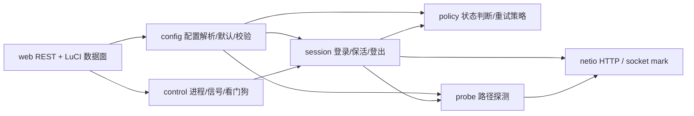

# ESurfingClient 模块边界与代码映射

> 目标架构文档（当前代码映射到现状；接口列出当前接口和推荐稳定边界）。多拨的基本单元是一个账号/会话/线路实例。OpenWrt `--role auth --account N` 进程只拥有本账号状态；不能把其他账号的线路探测结果用于该进程的认证决策。

## 1. 模块边界



依赖单向约束：`config` 和基础设施不依赖业务层；`policy` 可以消费 session/probe 的结果类型，但不发 HTTP；`session` 与 `probe` 通过 `netio` 发请求；`control` 驱动 session 生命周期但不解析协议；`web` 通过 API/control 读写状态，不直接操作 socket 或协议密码器。当前仍有若干全局函数/状态，图表示目标边界，不意味着已完成物理拆分。

## 2. 对外接口（函数签名级别）

签名以 C 头文件风格描述；结构体建议集中定义在各模块公开头中，调用方不应访问内部全局变量。

| 模块 | 建议公开接口 | 职责/约束 |
|---|---|---|
| config | `bool config_load(const char *path, runtime_config_t *out);` `bool config_validate(runtime_config_t *cfg, config_diag_t *diag);` `void config_defaults(runtime_config_t *out);` | JSON 解析、缺项默认、范围校验与告警。向上只输出有效配置；不发网络请求。 |
| session | `session_result_t session_authenticate(session_t *s);` `session_result_t session_keepalive(session_t *s);` `session_result_t session_logout(session_t *s, logout_reason_t reason);` `void session_reset(session_t *s);` | 单账号会话状态机；将错误分类结果交 policy；不自行等待/调度多账号。 |
| probe | `probe_result_t probe_check_path(const probe_context_t *ctx);` `void probe_start(const probe_context_t *ctx);` `void probe_stop(void);` | 仅判路径互联网/门户/不可达；上下文必须显式含本账号索引/mark；不能宣告会话有效。 |
| policy | `retry_decision_t policy_next_retry(const runtime_config_t *cfg, retry_class_t cls, unsigned attempt, uint64_t entropy);` `bool policy_should_reauth(probe_result_t p, session_result_t s);` | 纯策略计算，无 I/O；负责次数、间隔、随机抖动和状态转换。当前阶段先接配置，不引入调度层。 |
| netio | `curl_resp_t netio_get(const net_request_t *req);` `curl_resp_t netio_post(const net_request_t *req);` `curl_socket_t netio_open_socket(void *ctx, curlsocktype purpose, struct curl_sockaddr *addr);` | HTTP/CURL 与 mark 绑定。request context 显式传入账号 mark/caller；不得依赖调用线程 TLS 推导探测 mark。 |
| control | `int control_run_auth(uint8_t account_no);` `void control_request_stop(stop_reason_t reason);` `void control_watchdog_pet(watchdog_kind_t kind);` | init/procd 或监督进程所需的单实例生命周期、信号、看门狗；不改 mwan3、不负责线路分配。 |
| web | `bool web_api_get_status(web_status_t *out);` `bool web_api_get_config(runtime_config_t *out);` `bool web_api_save_config(const runtime_config_t *cfg);` | REST JSON 与 LuCI 数据适配；认证/保活仍由 session 处理。 |

## 3. 现有文件到目标模块映射

| 现有文件/目录 | 目标模块 | 当前作用/边界说明 |
|---|---|---|
| `app/src/config/Config.c` | config | 读配置、按账号筛选、校验账号；加载后填充全局状态。 |
| `app/src/config/ConfigDefaults.c`、`ConfigTimeWindow.c`、`ConfigAccounts.c`、`app/include/config/Config.h` | config | 默认值补全、时间窗口、账号模型/配置接口。 |
| `app/src/core/States.c`、`app/include/core/States.h` | config/session/policy 状态（待收敛） | 当前集中定义全局配置与状态，是多个模块共享访问的过渡点。 |
| `app/src/dialer/DialerAuth.c`、`DialerSession.c`、`DialerTicket.c`、`DialerLocation.c`、`DialerNet.c`、`DialerServer.c`、`LogoutState.c`、`ErrorCode.c`、`DialerClient.c` | session（部分 policy） | 登录流程、取票、心跳、登出、错误码和主循环；`DialerClient.c` 当前同时包含状态机与重试等待。 |
| `app/src/net/CheckNetwork.c` | probe | generate_204/认证服务器 HTTP 探测、Web 后台缓存。目标是逐账号线路探测；Web aggregate probe 目前没有账号上下文。 |
| `app/src/net/NetClient.c`、`NetClientCurl.c`、`NetClientInternal.h`、`NetTraffic.c`、`app/include/net/*` | netio | CURL、headers、SO_MARK、响应处理和流量采样。`NetClientCurl.c` 放 socket callback，NetClient 请求函数负责绑定上下文。 |
| `app/src/control/*`、`app/include/control/*` | control | 本机控制 IPC。 |
| `app/src/supervisor/*`、`app/include/supervisor/*`、`app/src/utils/runtime/*`、`app/src/Main.c`、`files/etc/init.d/esurfingclient` | control | 进程角色、生命周期、看门狗、信号、OpenWrt procd 实例入口。 |
| `app/src/webserver/*`、`app/include/webserver/*`、`app/src/webserver/WebApi*.c` | web | REST endpoints、web server、日志/配置/状态 API。 |
| `luci-app-esurfingclient/rootfs/www/luci-static/resources/view/esurfingclient.js` | web | 新版 LuCI JS UI。 |
| `luci-app-esurfingclient/rootfs-legacy/usr/lib/lua/luci/view/esurfingclient.htm`、同目录 controller | web | 旧版 LuCI 页面及路由。 |
| `app/src/cipher/*`、`app/include/cipher/*` | session 内部协议依赖 | 算法工厂/加解密；由 session 调用，不依赖 probe/policy/web。 |
| `app/src/utils/{log,time,text,platform}/*`、`app/third_party/*` | 基础设施 | 日志、单调钟、文本/平台工具、已有 vendor；不新增依赖。 |

## 4. 共享全局状态与收敛路径

| 当前共享状态 | 共享原因 | 收敛方向 |
|---|---|---|
| `g_prog_status[]` / `g_prog_cnt` | 既有单进程多账号线程模式、REST/control 查询账号运行态；OpenWrt auth 角色筛选后只有一个账号。 | 定义 `account_runtime_t`/`session_t`，按只读快照跨模块传递；账号私有 session 不被其他账号写。 |
| `tl_thread_idx`、`tl_thread_name` | 当前日志标识与大量单账号代码简化索引访问。 | 仅保留日志上下文用途；凡 socket mark、probe 等影响线路选择的行为都使用显式 context 参数。不可用 TLS 代替业务参数。 |
| `g_conn_timeout`、`g_op_timeout`、日志/端口/学校信息 globals | 避免当前大规模函数签名改造，启动时全进程唯一配置。 | 收入只读 `runtime_config_t`，传递给 session/netio/probe；兼容期保留 getter，避免 UI/协议代码直接写全局。 |
| `auth_cfg_t` 中 ticket/URL/cipher/tick | 单账号当前只有一份活动会话，组件共用协议上下文。 | 纳入 `session_t`，仅 session 子模块修改；网络请求按 request/context 传引用。 |
| `CheckNetwork.c` Web probe 缓存 | 页面轮询需要快速读取，避免每个 REST 请求同步探测卡住。 | 缓存 key 应带 account identity/mark；多线路状态 API 返回逐线路结果，不能一个共享 cache 冒充各账号状态。 |

### 生命周期注意

线程/回调的 userdata 必须在 CURL easy handle 完成/清理前保持有效。探测的 mark context 放在 `probe_t` 数组槽中，槽位在整个 `curl_multi_perform` 生命周期有效；普通 GET/POST 的 context 放在请求函数栈帧中，直到同步 `curl_easy_perform` 完成；认证测速的 context 数组与 handles 同生命周期。

## 5. 阶段 1 缺陷定位记录

根因是 `open_socket_callback()` 在 `NetClientCurl.c` 通过 `tl_thread_idx` 访问 mark，且只有 `tl_thread_idx >= 0` 时才调用 `setsockopt()`。认证进程的 `work_auth()` 在 `wait_need_auth()` 阶段直接探测网络；此时尚未进入 `dialer_app()` 设置账号 TLS 索引的代码，故该线程索引为初始 `-1`。curl callback 因而被调用但保护条件跳过 `SO_MARK`；“日志 0 次”来自成功日志只在该分支内，现新增的临时 WARN 诊断将直接打印 `caller/account_index/mark`，可区分“没走 callback”“收到 -1/0”“setsockopt 失败”“成功”。

修复方式：`check_network_status(connect_only, account_index)` 由认证调用点显式传入账号索引；`probe_add()` 按该索引读取 mark，存到其 `probe_t.mark_ctx`，并用 `CURLOPT_OPENSOCKETDATA` 传给回调。socket callback 不再从 TLS 查询探测 mark。普通认证 GET/POST、认证服务器测速也给 callback 设置稳定生命周期的显式 context。

### OpenWrt 虚拟机验证步骤

```sh
# 1. 构建并安装新包/二进制，确认版本和哈希为新构建
sha256sum /usr/bin/ESurfingClient

# 2. 临时将 log_lv 设为 6 后重启，清理旧日志便于观察
/etc/init.d/esurfingclient restart
logread -f | grep 'SO_MARK诊断'

# 3. auth 进程进入启动探测时应看到 tl_thread_idx=-1、account_index=0、mark=0x200，且有“诊断成功”
# 4. 对照路由计数器，在触发该账号探测前后采样；预期 mark 对应 wan3_dev 的探测包增加，dummy0 不增加
ip -s link show wan3_dev
ip -s link show dummy0

# 5. 如输出“诊断跳过”或“设置 SO_MARK 失败”，按 caller/index/errno 定位；确认非 root/缺少 CAP_NET_RAW 时也检查内核 SO_MARK 权限。
```

当前执行环境不含 OpenWrt VM，以上为可复现步骤，不是本机已完成的实机验收。诊断日志现在使用 WARN 级别，确认修复后应删除或降回 VERBOSE，避免正常运行日志放大。
